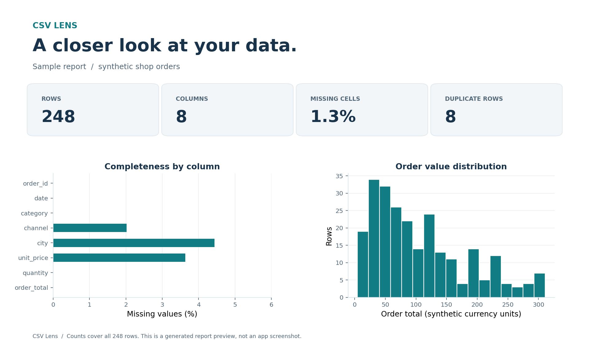

# CSV Lens

**Understand a CSV before you work with it.**

A small Python app for checking completeness, finding duplicate rows, exploring
columns, and downloading a portable data-quality summary.

*Generated from the bundled synthetic sample. The interactive app has upload,
column selection, and report download controls.*

## What it does

- Load your CSV or explore the bundled sample immediately.
- Inspect row counts, missing values, exact duplicate rows, and column types.
- Plot numeric distributions, common categorical values, and numeric relationships.
- Download a JSON report with counts, column statistics, and their definitions.
- Choose UTF-8, GB18030, or Latin-1 and comma, semicolon, tab, or pipe delimiters.

## Run locally

Requires Python 3.11 or newer. The pinned environment is tested on Python 3.13.

~~~bash
git clone https://github.com/Hayiwei/csv-lens.git
cd csv-lens
python -m venv .venv
~~~

Activate the environment:

~~~powershell
# Windows PowerShell
.\.venv\Scripts\Activate.ps1
~~~

~~~bash
# macOS / Linux
source .venv/bin/activate
~~~

Then install and launch:

~~~bash
python -m pip install -r requirements.txt
python -m streamlit run app.py
~~~

Open the localhost address printed by Streamlit. The app starts with the sample
dataset, so no upload or API key is needed.

## A few deliberate choices

**Inspection, not automatic cleaning.** Data is summarized without dropping
duplicates, filling missing cells, or changing suspicious values.

**Explicit counts.** Missing values include pandas' default NA tokens, empty
fields, and whitespace-only cells. Duplicate counts exclude the first occurrence
and use full rows after missing-value normalization. Unique counts exclude nulls.
Numeric statistics use finite values only; infinity is counted separately.

**Bounded inputs.** Files are limited to 20 MiB, 100,000 rows, and 200 columns.
Reported counts cover the complete loaded file. Plots sample at most 5,000 rows
with a fixed seed. Parsing errors are shown rather than silently skipping rows.

**Simple type inference.** pandas infers numbers; date-like values stay text.
Duplicate column headings are disambiguated by pandas. This is a quick first
look, not a schema validator or a substitute for domain-specific checks.

**Local by default.** Uploaded bytes are processed by the running Streamlit
server. Application code does not persist uploads or send them to external APIs.
If you deploy it elsewhere, that server receives the uploads.

## Development

~~~bash
python -m pip install -r requirements-dev.txt
python -m pytest -q
python scripts/make_sample.py
python scripts/make_preview.py
~~~

Tests cover parser edge cases, count definitions, limits, finite-value handling,
and the app's sample, exploration, and empty-upload states.

The sample and preview are reproducible; see [data provenance](data/README.md).

## Project layout

~~~text
app.py                 Streamlit interface
csv_lens/core.py        Parsing and profiling logic
data/                  Synthetic sample and provenance
scripts/               Sample and preview generation
tests/                 Core and app checks
~~~

Built with pandas, NumPy, Plotly, and Streamlit. MIT licensed.
See [development notes and plotting credits](docs/development.md).
